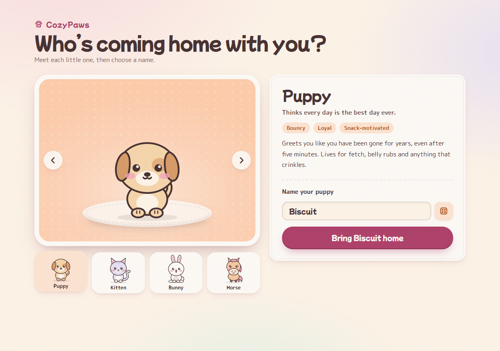
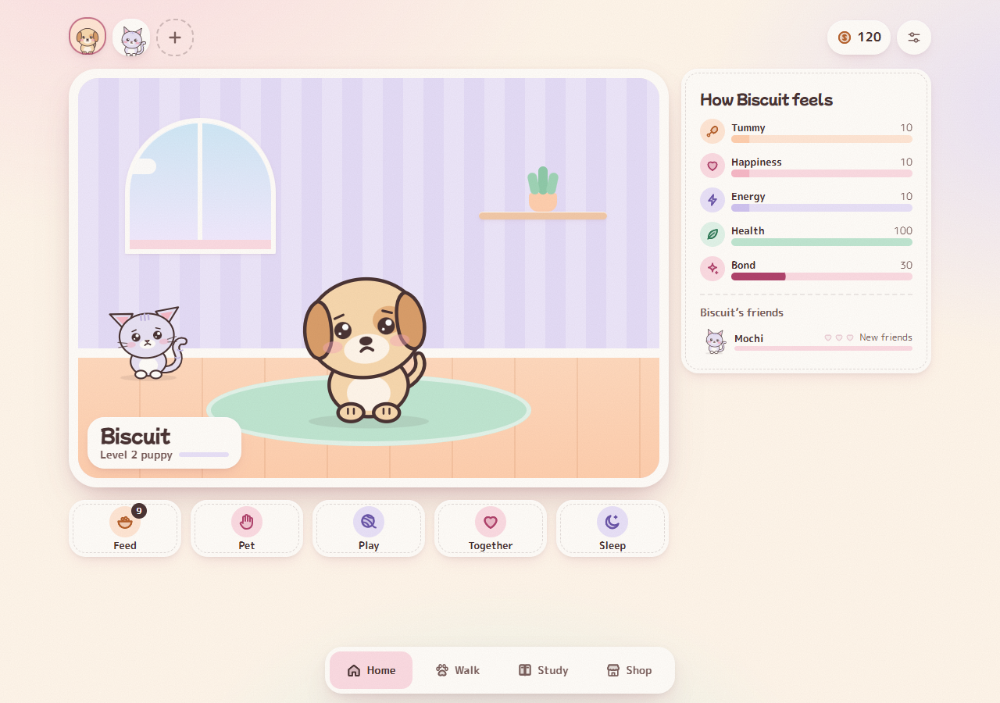
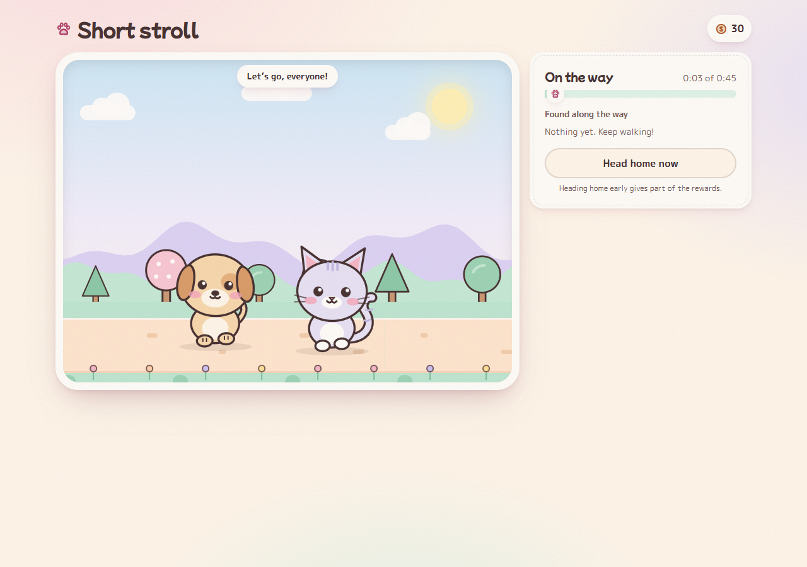
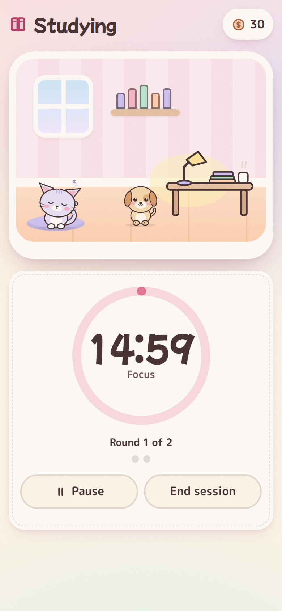
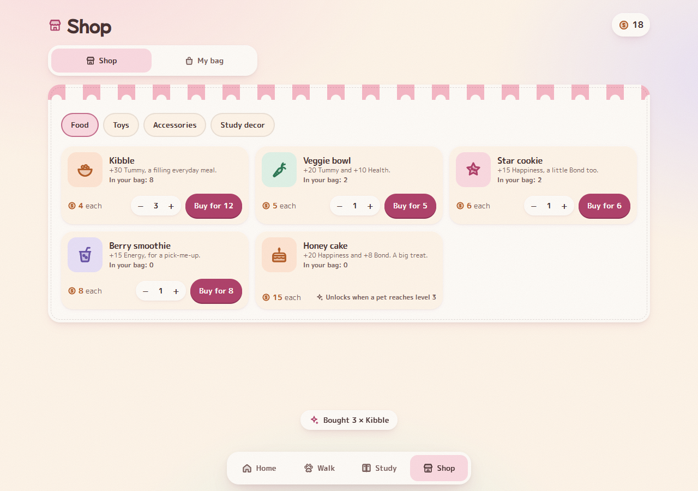

# CozyPaws

A cosy virtual pet game for the browser. Adopt a puppy, kitten, bunny or horse, look after them day to day, take them on walks, and keep them close while you study.



## The pets

| Pet | Personality |
| --- | --- |
| **Puppy** | Bouncy, loyal and snack-motivated. Thinks every day is the best day ever. |
| **Kitten** | Curious, independent and an expert napper. Impressed by nothing. |
| **Bunny** | Gentle and shy at first, then your little shadow. Loves veggies. |
| **Horse** | Calm, steady and always up for an adventure. Loves long walks. |

You name your first pet and can adopt up to four. Each pet keeps their own stats and level, and the whole household shares coins and food.

## How to play

### Home



Every pet has five stats: **Tummy**, **Happiness**, **Energy**, **Health** and **Bond**. They drift down over time, so check in to feed, pet, play with and put your pets to bed. Pets react to what you do and show how they feel. Caring for them earns XP, and they level up as they grow.

### Together

When you have more than one pet, they can do things with each other:

- play catch or tug with a buddy
- nap together in a cuddle pile (pets who are pals rest faster)
- sit down to dinner as a family
- wander over and say hello to each other on their own

Every pair of pets builds a friendship, from *New friends* to *Pals*, *Good friends* and finally *Best friends*.

### Walks



Take one pet or the whole group to the park, on a *Short stroll* or the longer *Meadow loop*. Along the way you might find acorns, snacks, butterflies, flowers, a bench to rest on or a friendly face. Group walks can splash through puddles together. When you get home you'll see what everyone found and earned.

### Study



A Pomodoro-style focus timer with your pets for company. Choose focus and break lengths and how many rounds to do, then pick whether each pet naps beside you or hangs out. Focused minutes earn coins and XP, and the pets get their own rewards as well.

### Shop and bag



Spend coins on:

- **Food:** kibble, veggie bowls, star cookies, berry smoothies and honey cake
- **Toys:** a feather wand and a bubble wand, each adding a new game to Play
- **Accessories:** bows, bandanas and flower crowns
- **Study decor:** fairy lights and a desk plant for your study room

Some items unlock as your pets level up or become friends. Dress your pets up from the wardrobe in **My bag**.

### Every day

- **Daily goals:** three new goals each day. Claim them for coins, and finish all three to get a honey cake.
- **Welcome back:** after you've been away a while, a summary shows how everyone got on.
- **Sound effects:** gentle sounds you can turn off in Settings.

Your game saves automatically in the browser, including walks and study sessions in progress. You can start over from **Settings → New game**.

The save belongs to one browser at one web address. To play on a different link (each Vercel or Netlify deploy gets its own) or another device, open **Settings → Move your pets**, copy the save code, and paste it into the game there. On a fresh start, use **Played before? Paste a save code**. Share your stable production address, not a per-deploy link, so players keep their save across updates.

## Built with

React, TypeScript, Vite, Tailwind CSS and Motion. The pets are drawn and animated in code as SVG.

## Run it locally

You need [Node.js](https://nodejs.org/).

```bash
npm install
npm run dev      # starts the game at http://localhost:3001
npm test         # runs the unit tests
npm run build    # makes a production build in dist/
```
